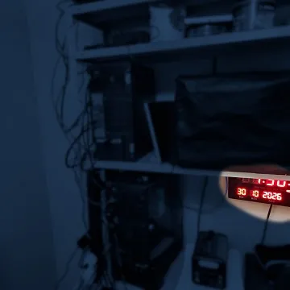

{
  "title": "couldn't initialize inotify",
  "publishDate": "2026-10-30T02:40:00-03:00",
  "categories": ["posts"]
}

Let me share my little milestone :)

A tiny technical event that means nothing to anyone else.  
But to me, it was a reminder that dreams can come true. You just need to work on them.

<!--more-->

I've had this one since 2009, a little after AWS started becoming a thing.  
The concept is simple: **Can I have all the digital services I need, right here at home?**  
Not just "git clone" a bunch of projects and host them. No.  
I wanted to actually have a reliable environment where they work together.

And today, around midnight, I unknowingly hit a ceiling that made me realize, "hey, I think I made it!"

While setting up yet another service, CrowdSec suddenly refused to start.  
After investigating what was going on, I discovered that, even with scale-to-zero, my little server had reached a default Linux resource limit.

And that made me happy :D

For the past two years, I've been building, breaking, rebuilding, and slowly stabilizing my homelab.  
I've explored 500+ projects along the way. So many diamonds, but damn, SO MUCH SLOP.  
Some projects lasted a few minutes. Others took days to boot up, only for me to realize they weren't what I was looking for.  
And a special few I ping every 30 seconds, every day.

GitHub? I found [Forgejo](https://forgejo.org/)  
Gmail? [MailServer](https://docker-mailserver.github.io/)  
Jira? [Plane](https://plane.so/)  
Zoom? [MiroTalk](https://sfu.mirotalk.com/)  
Drive? [OwnCloud](https://owncloud.com/)  
Calendar? [Radicale](https://radicale.org/v3.html)  
Calendly? [EasyAppointments!](https://easyappointments.org/)  
Slack? [Matrix](https://matrix.org/)  
Keycloak? [Authentik](https://goauthentik.io/)

And many, many, maaaaaaaany more.

Over time, I built my own images, private registry, reverse proxies, authentication, certificate management, networking, routing, security, monitoring, backups, and scaling.  
Today, this little box has grown into an environment with hundreds of containers, dozens of networks and VPNs, and thousands of people using it every day!

Chasing numbers was never the goal. Hitting that limit just reminded me how far I'd come.

**I finally built what I've been dreaming of all this time. I made it! And I'm proud of what I've done.**

A reliable, self-hosted environment that provides all the digital services I need, with no subscriptions. Free, forever.  
Of course, it's not free in terms of hardware, electricity, or maintenance. And definitely not in terms of time xD  
But it's mine. I understand how it works, I can change it, I can bend the services to do my will, and I get to decide what happens to it.

Looking back, I can't even count how many nights I spent troubleshooting something that should have taken five minutes.  
And somehow, I enjoyed most of them.

For that, I want to thank God for giving me the opportunity, the curiosity, the knowledge, and the time to witness what a little box sitting at home could become.  
And I want to thank my family for all the time and patience they've given me throughout this journey.

So yes, today's milestone was just hitting a Linux resource limit.  
But for me, I can finally say: **I made a dream I've had for 17 years come true.**

And now that it's stable (almost, I just need a little longer), I want to start sharing more about what you can build at home too.  
It's not easy, but it's fun!

See you soon o/

(ps: in case someone wants the fix, try sudo sysctl -w fs.inotify.max_user_instances=1024. You'll need to persist it in your sysctl config later.)
